# linux-server-lifecycle

**Lab-Projekt: Einen Ubuntu-Server mit Ansible bereitstellen, absichern, überprüfen, sichern und wiederherstellen**

In diesem Projekt wollte ich den gesamten Lebenszyklus eines Linux-Servers praktisch durchspielen. Es ging mir nicht nur darum, einen Ubuntu-Server zu installieren, sondern auch darum, ihn mit Ansible zu konfigurieren, grundlegende Sicherheitsmaßnahmen umzusetzen und anschließend zu überprüfen, ob sich wichtige Daten zuverlässig sichern und wiederherstellen lassen.

Die einzelnen Schritte habe ich dokumentiert, einschließlich der Probleme, auf die ich gestoßen bin, und der Lösungen, die ich ausprobiert habe.

## Phase 0.1 — Projektplanung und Abgrenzung

### Durchgeführte Schritte

Am Anfang habe ich überlegt, wie ich die verschiedenen Aufgaben sinnvoll zu einem zusammenhängenden Projekt verbinden kann. Der Server sollte nicht einfach nur installiert werden. Mein Ziel war ein vollständiger Ablauf von der Bereitstellung bis zur Wiederherstellung nach einem simulierten Datenverlust.

Dabei habe ich gemerkt, dass der ursprünglich geplante Umfang ziemlich groß war. Deshalb habe ich das Projekt bewusst eingegrenzt:

- Ein Ubuntu-Server als Zielsystem
- Ein separater Control Node für Ansible
- Keine zusätzliche Monitoring- oder SIEM-Lösung
- Eine Auswahl grundlegender CIS-Kontrollen (Level 1)
- Ein Backup-Werkzeug
- Ein vollständiger Test des gesamten Ablaufs

Die Reihenfolge habe ich folgendermaßen festgelegt:

**Grundlagen → Provisioning → Hardening & Audit → Backup & Restore → vollständiger Durchlauf → Dokumentation**

Die geplante Architektur sieht so aus:


### Probleme und Lösungen

**Unterschied zwischen VM-Bereitstellung und Systemkonfiguration**

Anfangs war mir nicht ganz klar, was genau unter Provisioning fällt. Einerseits gehört dazu das Erstellen einer virtuellen Maschine, andererseits auch das Einrichten des Betriebssystems.

Mir wurde klar, dass Ansible hauptsächlich für die Konfiguration eines bereits vorhandenen Systems eingesetzt wird. Deshalb habe ich diese beiden Aufgaben voneinander getrennt.

**Zu großer Projektumfang**

Ursprünglich wollte ich zusätzliche Funktionen integrieren. Dadurch wäre das Projekt aber unnötig kompliziert geworden.

Ich habe mich deshalb entschieden, zunächst einen funktionierenden Gesamtablauf aufzubauen und diesen zuverlässig zu testen.

### Was ich gelernt habe

- Ansible arbeitet agentlos. Es verbindet sich per SSH mit dem Zielsystem. Dafür benötigt der Server SSH, Python und einen Benutzer mit `sudo`-Berechtigung.
- Control Node und Managed Node übernehmen unterschiedliche Aufgaben.
- Unter Windows benötige ich für den Ansible Control Node beispielsweise WSL2 oder eine Linux-VM.
- Idempotenz bedeutet, dass ein Playbook mehrfach ausgeführt werden kann, ohne bei jedem Durchlauf unnötige Änderungen vorzunehmen.
- Ein Backup sollte nicht ausschließlich auf dem System liegen, das gesichert wird.
- Ein Sicherheitsaudit ist nur nachvollziehbar, wenn ich den Zustand vor und nach den Änderungen vergleiche.

## Phase 0.2 — Lab-Umgebung prüfen (Hyper-V)

### Durchgeführte Schritte

Bevor ich neue virtuelle Maschinen erstellt habe, wollte ich wissen, ob mein Rechner dafür genug Ressourcen hat.

Dafür habe ich zunächst einige Informationen über Windows, den Prozessor, den Arbeitsspeicher und den verfügbaren Festplattenspeicher abgefragt.

```powershell
Get-ComputerInfo | Select-Object WindowsProductName, WindowsVersion, OsTotalVisibleMemorySize
Get-CimInstance Win32_Processor | Select-Object Name, NumberOfCores, NumberOfLogicalProcessors
Get-PSDrive -PSProvider FileSystem
```

Das Ergebnis:

- Windows 10 Pro
- Etwa 13,9 GB RAM (14.528.572 KB ÷ 1024 ÷ 1024)
- AMD Ryzen 7 mit 8 Kernen und 16 Threads
- Ungefähr 330 GB freier Speicherplatz

Damit waren genügend Ressourcen für mehrere kleine virtuelle Maschinen vorhanden.

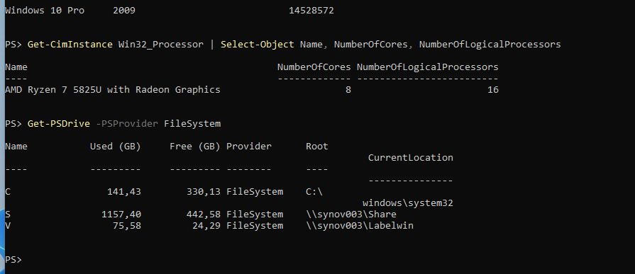

Danach habe ich mir die vorhandene Hyper-V-Konfiguration angesehen. Die PowerShell habe ich dafür als Administrator geöffnet.

```powershell
Get-VM
Get-VMSwitch
Get-VMHost | Select-Object VirtualMachinePath, VirtualHardDiskPath
```

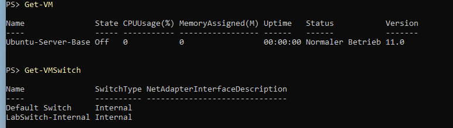

Auf meinem Rechner gab es bereits eine VM mit dem Namen `Ubuntu-Server-Base`.

Ich wollte wissen, wie sie konfiguriert ist, und habe deshalb ihre Hardware, die virtuelle Festplatte, die Netzwerkadapter und mögliche Checkpoints überprüft.

```powershell
Get-VM -Name Ubuntu-Server-Base | Format-List Name, Generation, ProcessorCount, MemoryStartup, DynamicMemoryEnabled, Path
Get-VMHardDiskDrive -VMName Ubuntu-Server-Base | ForEach-Object { Get-VHD -Path $_.Path } | Select-Object Path, VhdType, Size, FileSize
Get-VMNetworkAdapter -VMName Ubuntu-Server-Base | Select-Object Name, SwitchName
Get-VMSnapshot -VMName Ubuntu-Server-Base
```

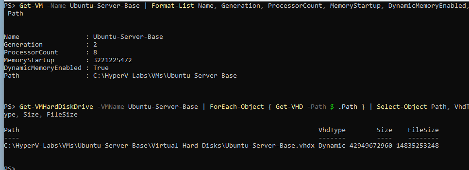

Anschließend habe ich noch die Netzwerkkonfiguration geprüft.

```powershell
Get-NetNat
Get-NetIPAddress -InterfaceAlias "vEthernet (LabSwitch-Internal)" -AddressFamily IPv4 | Select-Object IPAddress, PrefixLength
```

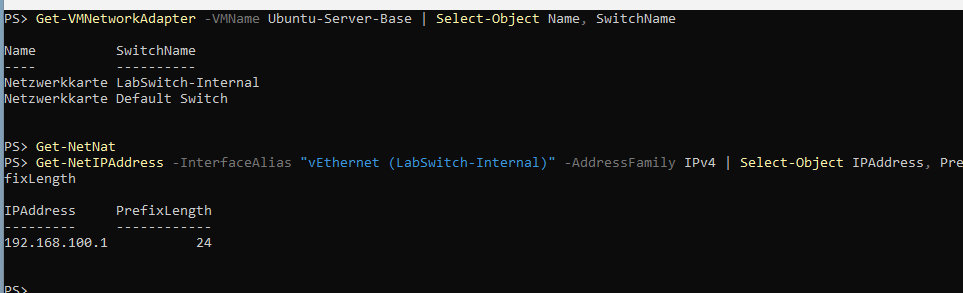

Dabei habe ich folgende Informationen festgestellt:

Die vorhandene VM gehört zur Generation 2 und verwendet 3 GB dynamischen Startspeicher. Ihre virtuelle Festplatte kann bis zu 40 GB groß werden, wovon ungefähr 13,8 GB belegt waren.

Checkpoints waren keine vorhanden.

Außerdem hatte die VM zwei Netzwerkadapter:

- `LabSwitch-Internal` für das interne Lab-Netz mit der Host-Adresse `192.168.100.1/24`
- `Default Switch` für den Internetzugang

Ein eigener NAT-Eintrag war nicht vorhanden.

### Probleme und Lösungen

**Fehlende Administratorrechte**

Beim ersten Versuch haben `Get-VM` und `Get-VMSwitch` nicht funktioniert. PowerShell meldete:

„Sie besitzen nicht die erforderliche Berechtigung für diese Aufgabe.“

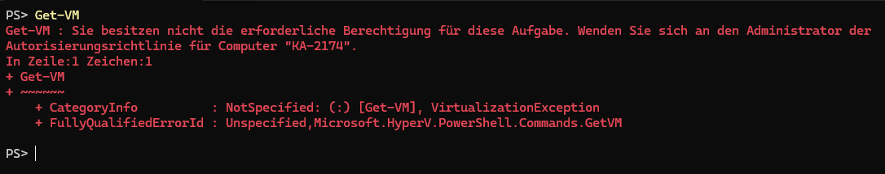

Ich hatte PowerShell ganz normal gestartet. Nachdem ich das Fenster geschlossen und PowerShell über „Als Administrator ausführen“ geöffnet hatte, funktionierten beide Befehle.

**Unsicherheit beim NAT**

Zuerst dachte ich, dass für den Internetzugang des Lab-Netzes ein NAT eingerichtet werden muss.

Da `Get-NetNat` keine Einträge zeigte, war ich zunächst unsicher.

Nach der Prüfung wurde aber klar, dass die zweite Netzwerkkarte über den `Default Switch` bereits für den Internetzugang zuständig ist. Das interne Lab-Netz konnte damit getrennt bleiben.

### Was ich gelernt habe

Hyper-V bietet drei verschiedene Switch-Typen:

- **External:** Verbindung zum echten Netzwerk
- **Internal:** Verbindung zwischen Host und virtuellen Maschinen
- **Private:** Verbindung nur zwischen virtuellen Maschinen

Für mein Projekt eignet sich ein Internal-Switch, weil ich damit ein eigenes Lab-Netz aufbauen kann.

Außerdem habe ich gelernt, dass Berechtigungsfehler bei Hyper-V häufig daran liegen, dass PowerShell nicht als Administrator gestartet wurde.

Beim Prüfen der Festplatten musste ich darauf achten, dass Speichergrößen korrekt umgerechnet werden. Für die Umrechnung von Bytes in GiB wird durch `1024³` geteilt.

Eine weitere wichtige Erkenntnis war, dass eine Basis-VM beim Klonen angepasst werden muss. Vor allem `machine-id` und die SSH-Host-Keys dürfen nicht einfach unverändert übernommen werden.

## Phase 0.3 — VM erstellen und Ubuntu Server installieren

### Durchgeführte Schritte

Nachdem die grundlegende Umgebung geprüft war, habe ich eine neue virtuelle Maschine für das Projekt erstellt.

Dafür habe ich folgende Ressourcen festgelegt:

- Generation 2
- 2 GB Arbeitsspeicher
- 2 virtuelle CPUs
- 25 GB dynamische Festplatte

Secure Boot habe ich aktiviert gelassen und die passende Vorlage für Linux ausgewählt.

Die Ubuntu-Server-ISO in Version 24.04.4 hatte ich bereits zuvor überprüft.

Die VM habe ich mit PowerShell erstellt:

```powershell
$vmName = "lab-ubuntu2404-base"
$vmPath = "C:\HyperV-Labs\Lifecycle"
New-Item -ItemType Directory -Path "$vmPath\$vmName" -Force

New-VM -Name $vmName -Generation 2 -MemoryStartupBytes 2GB -Path $vmPath `
  -NewVHDPath "$vmPath\$vmName\$vmName.vhdx" -NewVHDSizeBytes 25GB `
  -SwitchName "LabSwitch-Internal"
Set-VMProcessor -VMName $vmName -Count 2
Set-VMMemory -VMName $vmName -DynamicMemoryEnabled $false
Add-VMNetworkAdapter -VMName $vmName -SwitchName "Default Switch"

Add-VMDvdDrive -VMName $vmName -Path "C:\HyperV-Labs\ISOs\ubuntu-24.04.4-live-server-amd64.iso"
Set-VMFirmware -VMName $vmName -SecureBootTemplate "MicrosoftUEFICertificateAuthority"
Set-VMFirmware -VMName $vmName -FirstBootDevice (Get-VMDvdDrive -VMName $vmName)
```

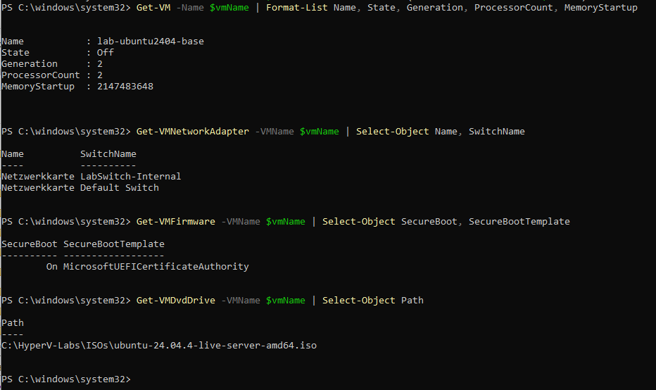

Bei der Ubuntu-Installation habe ich mich für folgende Einstellungen entschieden:

- Sprache: English
- Ubuntu Server, nicht die minimierte Variante
- Gesamte Festplatte mit LVM
- Keine Festplattenverschlüsselung
- OpenSSH-Server installieren
- Keine zusätzlichen Snaps

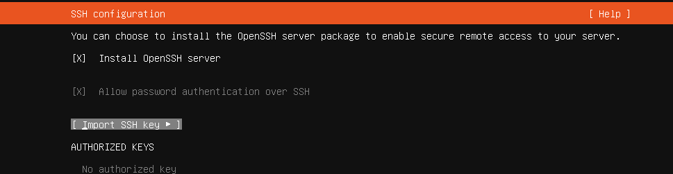

Nachdem die Installation abgeschlossen war, habe ich die ISO-Datei vom virtuellen DVD-Laufwerk getrennt.

```powershell
Set-VMDvdDrive -VMName $vmName -Path $null
```

Danach konnte ich mich zum ersten Mal am installierten Ubuntu-Server anmelden.

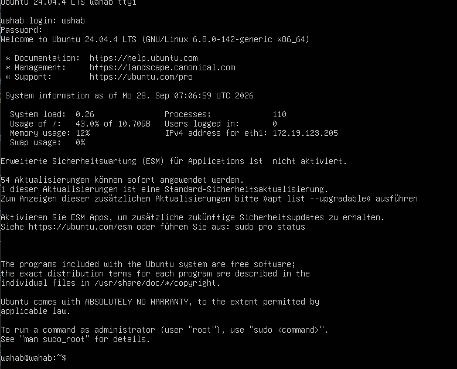

Anschließend habe ich das System genauer überprüft.

Dabei wurden folgende Versionen angezeigt:

- Ubuntu Server 24.04.4 LTS
- Kernel `6.8.0-142-generic`
- Python `3.12.3`

Die virtuelle Festplatte ist 25 GB groß. Die LVM-Gruppe verfügt über ungefähr 21,95 GB. Davon wurden etwa 11 GB dem Root-Dateisystem zugewiesen, während ungefähr 11 GB innerhalb der Volume Group frei blieben.

Außerdem waren 54 Updates verfügbar.

Für die Prüfung habe ich diese Befehle verwendet:

```bash
uname -r
lsblk
df -h /
sudo vgs
sudo lvs
ip -br a
ip -br link
systemctl is-active ssh
python3 --version
hostnamectl
```

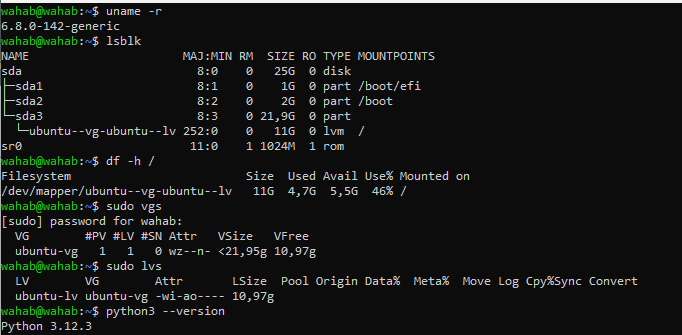

Die genaue Ubuntu-Version habe ich zusätzlich überprüft:

```bash
cat /etc/os-release
```

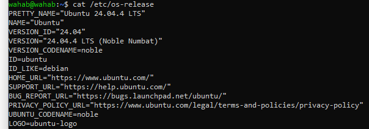

### Probleme und Lösungen

**Fehler beim Aushängen des Installationsmediums**

Am Ende der Installation erschien die Meldung:

`Failed unmounting cdrom.mount`

Ich habe die ISO-Datei über PowerShell getrennt und anschließend in der VM Enter gedrückt. Danach konnte ich normal weitermachen.

**SSH wurde als inactive angezeigt**

Beim ersten Test mit

```bash
systemctl is-active ssh
```

bekam ich die Ausgabe `inactive`.

Zunächst dachte ich, dass der SSH-Dienst nicht funktioniert. Bei Ubuntu 24.04 kann SSH aber über Socket Activation gestartet werden.

Deshalb habe ich den Socket und den offenen Port überprüft:

```bash
systemctl is-active ssh.socket
sudo ss -tlnp | grep ':22'
ssh-keygen -lf /etc/ssh/ssh_host_ed25519_key.pub
systemctl is-active ssh
```

Der Socket war aktiv und Port 22 wurde verwendet. Nach der ersten SSH-Verbindung war auch der SSH-Dienst aktiv.

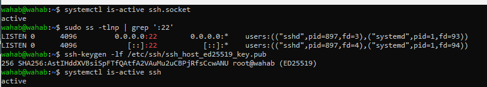

**Host-Key-Abfrage beim ersten SSH-Login**

Bei der ersten Verbindung erschien die Meldung `Host key verification failed`.

Ich hatte versucht, die Frage mit `y` oder `n` zu beantworten. Tatsächlich musste ich die Bestätigung vollständig als `yes` eingeben.

Vor der Bestätigung konnte ich den Fingerabdruck des Servers prüfen.

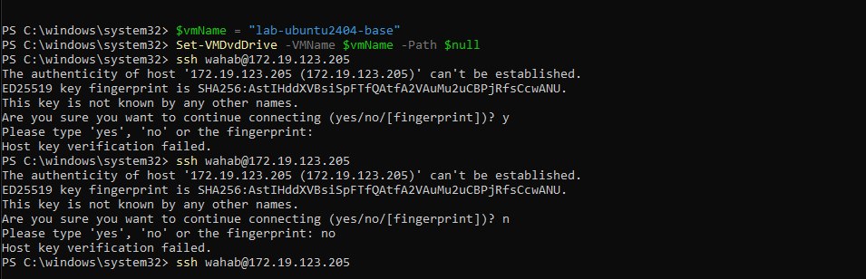

**Befehl in der falschen Shell ausgeführt**

Ein weiteres Problem entstand, als ich `Get-VMNetworkAdapter` eingegeben habe und die Meldung `command not found` erhielt.

Der Fehler lag daran, dass ich mich noch innerhalb einer SSH-Sitzung auf dem Ubuntu-Server befand.

Nach `exit` war ich wieder in der Windows-PowerShell und konnte den Befehl ausführen.

### Was ich gelernt habe

Durch die Erstellung der VM mit PowerShell kann ich nachvollziehen, welche Einstellungen ich verwendet habe. Die Befehle lassen sich außerdem für ähnliche Systeme wiederverwenden.

Ich habe auch verstanden, warum bei einer Linux-VM der Generation 2 die passende Secure-Boot-Vorlage wichtig ist.

Bei LVM bleibt während der Ubuntu-Installation häufig freier Speicher innerhalb der Volume Group. Dieser kann später für weitere Logical Volumes oder Snapshots verwendet werden.

Außerdem muss ich bei der Fehlersuche zwischen SSH-Dienst und SSH-Socket unterscheiden.

Besonders wichtig war für mich, immer darauf zu achten, in welcher Umgebung ich gerade arbeite:

- `PS C:\...>` bedeutet Windows-PowerShell.
- `wahab@wahab:~$` bedeutet Linux-Shell.

## Phase 0.4 — Lab-Netzwerk mit fester IP-Adresse

### Durchgeführte Schritte

Als Nächstes habe ich das Netzwerk eingerichtet.

Bei der ersten Prüfung war `eth0`, also die Netzwerkkarte für das Lab-Netz, noch `DOWN` und hatte keine IP-Adresse.

`eth1` war mit dem Hyper-V Default Switch verbunden und erhielt seine Adresse per DHCP.

In `/etc/netplan` befand sich zunächst nur die Datei `50-cloud-init.yaml`, in der `eth1` mit `dhcp4: true` konfiguriert war.

Um die Netzwerkadapter richtig zuzuordnen, habe ich die MAC-Adressen geprüft:

- `00155D016F03` → `eth0`
- `00155D016F04` → `eth1`

Die DHCP-Adresse von `eth1` hatte sich mehrfach geändert:

- `172.19.119.199`
- `172.19.123.205`
- `172.19.116.21`

Deshalb wollte ich diese Adresse nicht für die Verwaltung des Servers verwenden.

Stattdessen habe ich einen eigenen Internal-Switch für das Projekt erstellt, um mögliche Adresskonflikte mit anderen Lab-Umgebungen zu vermeiden.

```powershell
Get-NetIPAddress -AddressFamily IPv4 | Select-Object InterfaceAlias, IPAddress, PrefixLength
New-VMSwitch -Name "Lifecycle-Internal" -SwitchType Internal
New-NetIPAddress -InterfaceAlias "vEthernet (Lifecycle-Internal)" -IPAddress 10.99.0.1 -PrefixLength 24

Get-VMNetworkAdapter -VMName lab-ubuntu2404-base |
  Where-Object MacAddress -eq '00155D016F03' |
  Connect-VMNetworkAdapter -SwitchName "Lifecycle-Internal"
```

Auf dem Ubuntu-Server habe ich danach eine eigene Netplan-Datei erstellt.

```bash
sudo tee /etc/netplan/60-lab-netz.yaml > /dev/null <<'EOF'
network:
  version: 2
  ethernets:
    eth0:
      dhcp4: false
      addresses:
        - 10.99.0.10/24
EOF
sudo chmod 600 /etc/netplan/60-lab-netz.yaml
sudo netplan generate
sudo netplan try
```

Damit bekam `eth0` die feste Adresse `10.99.0.10/24`.

Nach dem Anwenden der Konfiguration habe ich die Verbindung vom Windows-Host getestet.

Der Ping-Test war erfolgreich: Vier von vier Paketen kamen an, ohne Paketverlust.

Auch die SSH-Verbindung über `10.99.0.10` funktionierte.

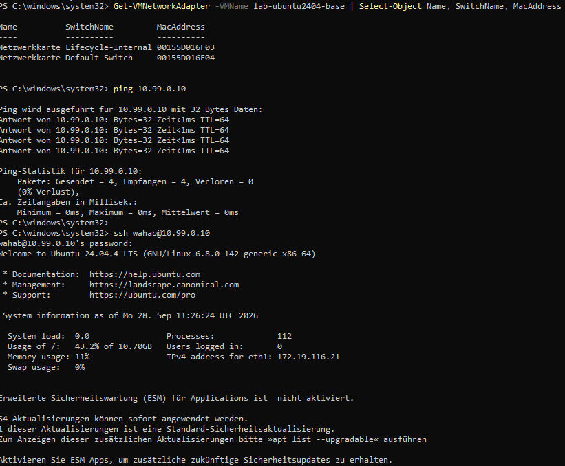

Zum Schluss habe ich die IP-Adressen und Routing-Tabelle überprüft.

```bash
ip -br a
ip route
```

Die Ausgabe zeigte, dass `eth0` die gewünschte Adresse verwendet und die Standardroute ausschließlich über `eth1` läuft.

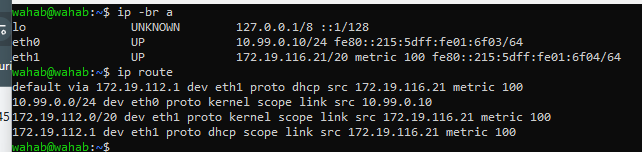

### Probleme und Lösungen

**Netzwerkadapter blieb DOWN**

Nach `netplan generate` war `eth0` weiterhin nicht aktiv.

Ich hatte zuerst angenommen, dass dieser Befehl die Einstellungen direkt übernimmt. Tatsächlich prüft und erzeugt er nur die Konfiguration.

Erst durch `netplan try` wurde die Änderung angewendet.

**Zwei Adapter mit demselben Namen**

In Hyper-V wurden beide Adapter als „Netzwerkkarte“ angezeigt. Dadurch war zunächst nicht eindeutig, welchen Adapter ich ändern musste.

Ich habe deshalb die MAC-Adresse als eindeutiges Merkmal verwendet.

**Ping in die Gegenrichtung**

Ein Ping von Ubuntu zum Windows-Host kann durch die Windows-Firewall blockiert werden.

Für die Überprüfung habe ich deshalb die Verbindung vom Windows-Host zur VM getestet.

### Was ich gelernt habe

Mit einem Internal-Switch kann ich ein eigenes Netzwerk zwischen Host und virtuellen Maschinen aufbauen.

Bei einem System mit zwei Netzwerkkarten muss ich besonders auf das Routing achten. In meinem Fall benötigt nur `eth1` eine Standardroute für das Internet.

Für `eth0` habe ich deshalb kein Gateway eingetragen.

Außerdem habe ich den Unterschied zwischen `netplan generate`, `netplan try` und `netplan apply` besser verstanden.

`netplan try` kann eine Konfiguration nach 120 Sekunden zurückrollen, wenn sie nicht bestätigt wird. Das ist besonders bei entfernten Netzwerkänderungen hilfreich.

Die vorhandene Cloud-init-Konfiguration habe ich nicht direkt verändert, sondern meine Einstellungen in einer eigenen Datei abgelegt.

## Phase 0.5 — Control Node erstellen

### Durchgeführte Schritte

Nachdem der Ziel-Server eingerichtet war, brauchte ich einen zweiten Rechner, von dem aus Ansible ausgeführt werden kann.

Dafür habe ich in Hyper-V eine weitere VM mit dem Namen `lab-control` erstellt.

Die Konfiguration:

- Generation 2
- 2 GB RAM
- 2 vCPU
- 20 GB virtuelle Festplatte
- `eth0` am Switch `Lifecycle-Internal`
- `eth1` am `Default Switch`

Die Erstellung erfolgte wieder über PowerShell.

```powershell
$vmName = "lab-control"
$vmPath = "C:\HyperV-Labs\Lifecycle"
New-Item -ItemType Directory -Path "$vmPath\$vmName" -Force

New-VM -Name $vmName -Generation 2 -MemoryStartupBytes 2GB -Path $vmPath `
  -NewVHDPath "$vmPath\$vmName\$vmName.vhdx" -NewVHDSizeBytes 20GB `
  -SwitchName "Lifecycle-Internal"
Set-VMProcessor -VMName $vmName -Count 2
Set-VMMemory -VMName $vmName -DynamicMemoryEnabled $false
Add-VMNetworkAdapter -VMName $vmName -SwitchName "Default Switch"

Add-VMDvdDrive -VMName $vmName -Path "C:\HyperV-Labs\ISOs\ubuntu-24.04.4-live-server-amd64.iso"
Set-VMFirmware -VMName $vmName -SecureBootTemplate "MicrosoftUEFICertificateAuthority"
Set-VMFirmware -VMName $vmName -FirstBootDevice (Get-VMDvdDrive -VMName $vmName)
```

Auf dem Control Node habe ich anschließend die feste IP-Adresse `10.99.0.20/24` eingerichtet.

```bash
sudo tee /etc/netplan/60-lab-netz.yaml > /dev/null <<'EOF'
network:
  version: 2
  ethernets:
    eth0:
      dhcp4: false
      addresses:
        - 10.99.0.20/24
EOF
sudo chmod 600 /etc/netplan/60-lab-netz.yaml
sudo netplan generate
sudo netplan apply
```

Danach habe ich die Netzwerkverbindung geprüft.

Sowohl Ping als auch SSH über `10.99.0.20` funktionierten. Die Routing-Tabelle zeigte außerdem nur eine Standardroute, die über `eth1` läuft.

### Probleme und Lösungen

Bei der Einrichtung dieser VM gab es mehrere Schwierigkeiten.

**Versehentlich die minimierte Ubuntu-Version installiert**

Ich habe zweimal die Option „Ubuntu Server (minimized)“ ausgewählt, obwohl ich ursprünglich die Standardinstallation verwenden wollte.

Bevor ich das System erneut installiert hätte, habe ich geprüft, ob die wichtigsten Komponenten vorhanden sind.

Python, SSH und apt funktionierten. Deshalb habe ich die minimierte Installation behalten.

**Fehlende Berechtigung bei Set-VMDvdDrive**

Der Befehl schlug zunächst fehl, weil PowerShell nicht als Administrator gestartet war.

Nach dem erneuten Öffnen mit Administratorrechten funktionierte er.

**Zu wenig verfügbarer Arbeitsspeicher**

Beim Start erschien die Meldung, dass 2048 MB RAM nicht reserviert werden konnten.

Mit `Get-VM` habe ich überprüft, welche virtuellen Maschinen bereits liefen. Nachdem ich Arbeitsspeicher freigegeben hatte, ließ sich die VM starten.

**Hyper-V-Konsole reagierte nicht auf Eingaben**

Obwohl die VM lief, konnte ich zeitweise nichts über das Konsolenfenster eingeben.

Ich habe die VM mit `Restart-VM -Force` neu gestartet und anschließend ein neues `vmconnect`-Fenster geöffnet.

Danach funktionierte die Eingabe wieder.

**Fehler beim Kopieren einer Konfigurationsdatei**

Beim Einfügen eines mehrzeiligen Textes in die Hyper-V-Konsole wurde eine Datei beschädigt.

Aus `network:` wurde versehentlich `n/network:`.

Ich habe die Datei gelöscht und sie über eine SSH-Verbindung erneut geschrieben. Anschließend habe ich den Inhalt mit `cat` kontrolliert.

**SSH-Verbindung nach netplan try verloren**

Beim Ausführen von `netplan try` wurde meine SSH-Verbindung getrennt. Die Änderung wurde daraufhin automatisch zurückgerollt.

Ich habe mich anschließend über die lokale Hyper-V-Konsole angemeldet und dort `netplan apply` verwendet.

### Was ich gelernt habe

Bei Netzwerkänderungen muss ich darauf achten, über welche Verbindung ich gerade angemeldet bin. Wenn ich genau diese Verbindung ändere, kann die SSH-Sitzung abbrechen.

Außerdem kontrolliere ich seitdem mehrzeilig eingefügte Konfigurationsdateien, bevor ich sie anwende.

Die minimierte Ubuntu-Installation reicht für meinen Ansible Control Node aus.

Auch ein Problem mit dem Hyper-V-Konsolenfenster bedeutet nicht automatisch, dass die VM selbst abgestürzt ist.

## Phase 0.6 — Ansible installieren und erste Verbindung

### Durchgeführte Schritte

Auf `lab-control` habe ich als Nächstes Ansible installiert.

```bash
sudo apt update
sudo apt install ansible -y
ansible --version
```

Installiert wurde `ansible [core 2.16.3]` mit Python `3.12.3`.

Danach habe ich im Verzeichnis `~/ansible-lab` eine Inventory-Datei erstellt.

**Datei: `inventory.ini`**

```ini
[ziel]
lab-ziel ansible_host=10.99.0.10 ansible_user=wahab
```

Damit kennt Ansible den Ziel-Server, dessen IP-Adresse und den Benutzer für die Verbindung.

Für die SSH-Anmeldung habe ich ein ED25519-Schlüsselpaar erstellt und den öffentlichen Schlüssel auf den Ziel-Server übertragen.

```bash
ssh-keygen -t ed25519 -C "ansible-lab-control" -f ~/.ssh/id_ed25519 -N ""
ssh-copy-id wahab@10.99.0.10
```

Anschließend habe ich die erste Verbindung mit dem Ansible-Ping-Modul getestet.

```bash
ansible ziel -i ~/ansible-lab/inventory.ini -m ping
```

Die Ausgabe war erfolgreich:

```text
lab-ziel | SUCCESS => {"ping": "pong"}
```

Damit war bestätigt, dass Ansible den Ziel-Server über SSH erreichen und dort Python verwenden kann.

### Probleme und Lösungen

**No route to host**

Beim ersten Verbindungsversuch bekam ich die Meldung `No route to host`.

Nach kurzer Prüfung stellte sich heraus, dass der Ziel-Server ausgeschaltet war.

Ich habe die VM in Hyper-V gestartet und den Test wiederholt.

**Permission denied (publickey,password)**

Beim nächsten Versuch wurde die SSH-Anmeldung abgelehnt.

Der öffentliche Schlüssel des Control Nodes war noch nicht auf dem Zielsystem hinterlegt.

Nachdem ich den Schlüssel mit `ssh-copy-id` übertragen hatte, funktionierte die Verbindung.

**sshpass fehlte**

Ein Versuch mit `--ask-pass` schlug fehl, weil `sshpass` nicht installiert war.

Statt das zusätzliche Paket einzurichten, habe ich mich für die Anmeldung mit SSH-Schlüsseln entschieden.

### Was ich gelernt habe

Das Ansible-Modul `ping` ist kein gewöhnlicher ICMP-Ping. Es überprüft, ob Ansible über SSH eine Verbindung zum Zielsystem herstellen und dort Python ausführen kann.

Für die Automatisierung ist eine Anmeldung mit SSH-Schlüsseln sinnvoll.

Der private Schlüssel bleibt dabei auf dem Control Node. Nur der öffentliche Schlüssel wird auf den Ziel-Server übertragen.

## Teil 1 — Provisioning: Erstes Playbook

### Durchgeführte Schritte

Nachdem die Verbindung funktioniert hatte, wollte ich die ersten Konfigurationsaufgaben mit Ansible automatisieren.

Dafür habe ich das Playbook `~/ansible-lab/provision.yml` erstellt.

Ich habe es nicht sofort vollständig geschrieben, sondern die Aufgaben nach und nach ergänzt.

Das fertige Playbook:

```yaml
---
- name: Erste einfache Provisioning-Schritte
  hosts: ziel
  become: true
  tasks:
    - name: Paketliste aktualisieren
      apt:
        update_cache: true

    - name: htop installieren
      apt:
        name: htop
        state: present

    - name: SSH-Dienst pruefen
      service:
        name: ssh
        state: started

    - name: SSH in der Firewall erlauben
      community.general.ufw:
        rule: allow
        name: OpenSSH

    - name: Firewall aktivieren
      community.general.ufw:
        state: enabled

    - name: Benutzer demo anlegen
      user:
        name: demo
        state: present
        shell: /bin/bash
```

Das Playbook übernimmt mehrere grundlegende Aufgaben:

Es aktualisiert die Paketliste, installiert `htop`, stellt sicher, dass SSH gestartet ist, erlaubt OpenSSH in der Firewall und aktiviert anschließend UFW.

Zusätzlich wird ein Testbenutzer namens `demo` angelegt.

Bevor ich die Änderungen tatsächlich ausgeführt habe, habe ich einen Testlauf mit `--check` durchgeführt.

```bash
ansible-playbook -i ~/ansible-lab/inventory.ini ~/ansible-lab/provision.yml --check --ask-become-pass
ansible-playbook -i ~/ansible-lab/inventory.ini ~/ansible-lab/provision.yml --ask-become-pass
```

Der echte Durchlauf endete mit:

```text
ok=7 changed=2
```

Dabei wurden die Paketliste aktualisiert und der Benutzer `demo` angelegt.

Die Firewall-Aufgaben meldeten bereits `ok`, weil sie durch einen vorherigen Lauf schon umgesetzt worden waren.

Zur Kontrolle habe ich mich am Ziel-Server angemeldet und die Einstellungen direkt überprüft.

```bash
sudo ufw status
id demo
```

UFW war aktiv und OpenSSH für IPv4 und IPv6 erlaubt.

Der Benutzer wurde ebenfalls gefunden:

```text
uid=1001(demo) gid=1001(demo) groups=1001(demo)
```

### Probleme und Lösungen

**Missing sudo password**

Beim ersten Testlauf erschien die Meldung `Missing sudo password`.

Ich hatte `become: true` im Playbook gesetzt, aber Ansible noch kein Passwort für die Rechteerhöhung zur Verfügung gestellt.

Mit dem zusätzlichen Parameter `--ask-become-pass` konnte ich das sudo-Passwort bei der Ausführung eingeben.

### Was ich gelernt habe

Mit Ansible lassen sich mehrere Konfigurationsaufgaben strukturiert in einem Playbook zusammenfassen.

`become: true` sorgt dafür, dass Aufgaben mit erhöhten Rechten ausgeführt werden können.

Besonders interessant war die Idempotenz. Beim erneuten Ausführen wurden bereits korrekt konfigurierte Einstellungen nicht noch einmal unnötig verändert.

Auch die Reihenfolge der Tasks ist wichtig.

Bevor ich eine Firewall aktiviere, muss ich sicherstellen, dass SSH weiterhin erlaubt ist. Sonst könnte ich mich selbst vom Server aussperren.

Mit `--check` kann ich vor der tatsächlichen Ausführung abschätzen, welche Änderungen Ansible vornehmen würde.

## Teil 2 — Hardening: SSH absichern und Benutzer bereinigen

### Ausgangslage

Nach dem Provisioning habe ich begonnen, den Server abzusichern.

Zuerst wollte ich wissen, welche SSH-Einstellungen tatsächlich aktiv sind.

Dafür habe ich auf dem Ziel-Server `sudo sshd -T` verwendet.

Die relevanten Werte waren:

```text
port 22
permitrootlogin without-password
passwordauthentication yes
```

Mein Ziel war es, den direkten Root-Login vollständig zu verbieten und die Anmeldung mit Passwort zu deaktivieren.

Die gewünschten Werte:

```text
PermitRootLogin no
PasswordAuthentication no
```

Port 22 habe ich bewusst unverändert gelassen.

### Durchgeführte Schritte

Für diese Änderungen habe ich auf dem Control Node die Datei `~/ansible-lab/harden.yml` erstellt.

Zuerst enthielt das Playbook nur die SSH-Härtung und das Entfernen des Testbenutzers.

```yaml
---
- name: SSH haerten
  hosts: ziel
  become: true
  tasks:
    - name: PermitRootLogin auf no setzen
      lineinfile:
        path: /etc/ssh/sshd_config
        regexp: '^#?PermitRootLogin'
        line: 'PermitRootLogin no'
      notify: sshd neu laden

    - name: PasswordAuthentication auf no setzen (Hauptdatei)
      lineinfile:
        path: /etc/ssh/sshd_config
        regexp: '^#?PasswordAuthentication'
        line: 'PasswordAuthentication no'
      notify: sshd neu laden

    - name: PasswordAuthentication auf no setzen (cloud-init ueberschreibt sonst)
      lineinfile:
        path: /etc/ssh/sshd_config.d/50-cloud-init.conf
        regexp: '^#?PasswordAuthentication'
        line: 'PasswordAuthentication no'
      notify: sshd neu laden

    - name: Testbenutzer demo entfernen
      user:
        name: demo
        state: absent
        remove: true

  handlers:
    - name: sshd neu laden
      service:
        name: ssh
        state: reloaded
```

Bevor ich das Playbook ausgeführt habe, ließ ich eine bestehende SSH-Sitzung zum Ziel-Server geöffnet.

Das war eine Sicherheitsmaßnahme, damit ich bei einer falschen Konfiguration noch eine Möglichkeit habe, auf das System zuzugreifen.

Danach habe ich das Playbook zunächst mit `--check` getestet und anschließend mit `--ask-become-pass` ausgeführt.

Die Ergebnisse habe ich auf drei Arten überprüft:

```bash
sudo sshd -T | grep -E "permitrootlogin|passwordauthentication"
ssh wahab@10.99.0.10
ssh wahab@10.99.0.10
```

Der erste Befehl wurde auf dem Ziel-Server ausgeführt.

Die zweite Verbindung habe ich von Windows ohne hinterlegten SSH-Schlüssel getestet. Sie wurde erwartungsgemäß mit `Permission denied (publickey)` abgelehnt.

Die dritte Verbindung erfolgte vom Control Node aus mit dem eingerichteten SSH-Schlüssel. Diese Anmeldung funktionierte weiterhin ohne Passwort.

Die Prüfung mit `sshd -T` zeigte außerdem für beide Einstellungen den Wert `no`.

Anschließend habe ich kontrolliert, ob der Testbenutzer entfernt wurde.

```bash
id demo
```

Das Ergebnis war `no such user`.

### Probleme und Lösungen

**PasswordAuthentication blieb trotz Änderung auf yes**

Das war eines der interessantesten Probleme während der Härtung.

Nach dem ersten Durchlauf meldete Ansible, dass die SSH-Konfiguration geändert wurde.

Trotzdem zeigte `sshd -T` weiterhin:

```text
passwordauthentication yes
```

Zunächst war mir nicht klar, warum die Änderung keine Wirkung hatte.

Bei der weiteren Untersuchung stellte ich fest, dass in `/etc/ssh/sshd_config` die folgende Include-Anweisung relativ weit oben steht:

```text
Include /etc/ssh/sshd_config.d/*.conf
```

Dadurch werden zusätzliche Konfigurationsdateien eingelesen.

In meinem Fall enthielt `/etc/ssh/sshd_config.d/50-cloud-init.conf` noch die Einstellung `PasswordAuthentication yes`.

Bei der SSH-Konfiguration gilt für solche mehrfach definierten Optionen in diesem Zusammenhang, dass der erste eingelesene Wert verwendet wird.

Die Einstellung aus der Cloud-init-Datei hatte deshalb Vorrang vor meiner späteren Änderung in der Hauptdatei.

Ich habe das Playbook daraufhin erweitert, damit auch die Datei `50-cloud-init.conf` angepasst wird.

Nach einem weiteren Durchlauf zeigte `sshd -T` endlich den gewünschten Wert `no`.

### Was ich gelernt habe

Eine erfolgreiche Ansible-Ausführung bedeutet noch nicht automatisch, dass die gewünschte Einstellung tatsächlich aktiv ist.

Gerade bei Sicherheitskonfigurationen muss ich deshalb das Ergebnis unabhängig überprüfen.

Außerdem habe ich gelernt, dass zusätzliche Konfigurationsdateien in `/etc/ssh/sshd_config.d/` einen großen Einfluss auf das tatsächliche SSH-Verhalten haben können.

Bei Änderungen an SSH werde ich künftig immer eine bestehende Verbindung geöffnet lassen und einen zweiten Verbindungstest durchführen, bevor ich die ursprüngliche Sitzung schließe.

## Teil 2 — Hardening: Benutzer, Dienste und Logging

### Benutzerbereinigung

Neben den SSH-Einstellungen habe ich überprüft, welche Benutzer auf dem System vorhanden sind.

Dabei habe ich insbesondere die relevanten Einträge in `/etc/passwd` betrachtet.

Zu den überprüften Konten gehörten:

- `root`
- `wahab`
- `demo`

Der Benutzer `demo` war nur für den Provisioning-Test angelegt worden und wurde anschließend nicht mehr benötigt.

Deshalb habe ich ihn mit Ansible entfernt.

Damit wollte ich vermeiden, dass unnötige Benutzerkonten dauerhaft auf dem System bleiben.

### Nicht benötigte Dienste

Danach habe ich mir angesehen, welche Dienste auf dem Server laufen.

Dafür verwendete ich:

```bash
systemctl list-units --type=service --state=running
```

Bei der ersten Überprüfung liefen 18 Dienste.

Da mein Ubuntu-Server ausschließlich als virtuelle Maschine im Lab verwendet wird, brauchte ich einige davon nicht.

Ich habe mich deshalb entschieden, folgende Dienste zu stoppen und zu deaktivieren:

- `ModemManager`
- `multipathd`
- `upower`
- `udisks2`
- `fwupd`
- `packagekit`

Die Entscheidung beruhte auf der Rolle dieses Systems.

Die VM benötigt beispielsweise kein Modem und keine Akkuverwaltung. Auch die Paketverwaltung sollte in diesem Projekt hauptsächlich über apt und Ansible erfolgen.

Den Dienst `polkit` habe ich dagegen bewusst nicht deaktiviert.

Ich konnte nicht sicher ausschließen, dass andere Komponenten davon abhängig sind. Deshalb wollte ich durch eine zusätzliche Härtungsmaßnahme kein unnötiges Funktionsrisiko eingehen.

Nach den Änderungen reduzierte sich die Zahl der laufenden Dienste von 18 auf 14.

### Logging

Als Nächstes habe ich die Protokollierung überprüft.

In `/var/log/auth.log` konnte ich sehen, dass Anmeldungen und sudo-Aktionen protokolliert werden.

Anschließend habe ich die Logrotate-Konfiguration in `/etc/logrotate.d/rsyslog` kontrolliert.

Die ursprünglichen Einstellungen enthielten:

```text
weekly
rotate 4
```

Das bedeutet eine wöchentliche Rotation mit vier aufbewahrten älteren Logdateien.

Für mein Projekt wollte ich die Aufbewahrung verlängern, damit ich Ereignisse über einen größeren Zeitraum nachvollziehen kann.

Deshalb habe ich den Wert auf `rotate 12` erhöht, was bei wöchentlicher Rotation ungefähr zwölf Wochen entspricht.

### Vollständiges Hardening-Playbook

Nach diesen Ergänzungen sah meine vollständige Datei `harden.yml` folgendermaßen aus:

```yaml
---
- name: SSH haerten
  hosts: ziel
  become: true
  tasks:
    - name: PermitRootLogin auf no setzen
      lineinfile:
        path: /etc/ssh/sshd_config
        regexp: '^#?PermitRootLogin'
        line: 'PermitRootLogin no'
      notify: sshd neu laden

    - name: PasswordAuthentication auf no setzen (Hauptdatei)
      lineinfile:
        path: /etc/ssh/sshd_config
        regexp: '^#?PasswordAuthentication'
        line: 'PasswordAuthentication no'
      notify: sshd neu laden

    - name: PasswordAuthentication auf no setzen (cloud-init ueberschreibt sonst)
      lineinfile:
        path: /etc/ssh/sshd_config.d/50-cloud-init.conf
        regexp: '^#?PasswordAuthentication'
        line: 'PasswordAuthentication no'
      notify: sshd neu laden

    - name: Testbenutzer demo entfernen
      user:
        name: demo
        state: absent
        remove: true

    - name: Nicht benoetigte Dienste stoppen und deaktivieren
      systemd:
        name: "{{ item }}"
        state: stopped
        enabled: false
      loop:
        - ModemManager.service
        - multipathd.service
        - upower.service
        - udisks2.service
        - fwupd.service
        - packagekit.service

    - name: Logrotate-Aufbewahrung auf 12 Wochen erhoehen
      lineinfile:
        path: /etc/logrotate.d/rsyslog
        regexp: '^(\s*)rotate \d+'
        line: '\1rotate 12'
        backrefs: true

  handlers:
    - name: sshd neu laden
      service:
        name: ssh
        state: reloaded
```

### Probleme und Lösungen

**Dienste starteten erneut**

Nach dem ersten Deaktivieren stellte ich fest, dass `fwupd` und `packagekit` wieder als laufend angezeigt wurden.

Bei der Untersuchung wurde deutlich, dass diese Dienste durch D-Bus bei Bedarf erneut aktiviert werden können.

Ich habe daraufhin auch diese beiden Dienste ausdrücklich in das Hardening-Playbook aufgenommen.

Nach einem weiteren Durchlauf waren sie in meiner anschließenden Prüfung gestoppt.

**SSH-Schlüssel ohne Passphrase**

Beim Erstellen des SSH-Schlüssels auf `lab-control` habe ich bewusst keine Passphrase vergeben.

Für die isolierte Lab-Umgebung wollte ich eine möglichst unkomplizierte Automatisierung mit Ansible erreichen.

Mir ist dabei bewusst, dass eine Passphrase den privaten Schlüssel zusätzlich schützen würde. Ohne `ssh-agent` hätte sie die automatische Ausführung jedoch erschwert.

Diese Entscheidung habe ich deshalb als Ausnahme dokumentiert.

### Was ich gelernt habe

Mit `loop:` kann ich in Ansible dieselbe Aufgabe für mehrere Einträge ausführen. Dadurch wird das Playbook übersichtlicher.

Bei Diensten reicht es nicht immer, nur ihren aktuellen Status zu ändern. Einige können durch andere Mechanismen erneut gestartet werden.

Außerdem habe ich bei der Logrotate-Konfiguration gelernt, wie sich mit `lineinfile`, regulären Ausdrücken und `backrefs: true` einzelne Werte in einer Konfigurationszeile anpassen lassen, ohne die vorhandene Einrückung zu verlieren.

Eine wichtige Erkenntnis war für mich auch, dass nicht jede mögliche Härtungsmaßnahme automatisch sinnvoll ist.

Ich sollte verstehen, welchen Nutzen eine Änderung bringt und welche Auswirkungen sie auf das System haben kann.

Bewusste Ausnahmen sind deshalb in Ordnung, solange sie nachvollziehbar begründet werden.

## Compliance Audit — Vergleich zwischen Ist- und Soll-Zustand

### Vorgehensweise

Um meine Härtungsmaßnahmen nachvollziehbar zu überprüfen, habe ich den Zustand vor und nach den Änderungen verglichen.

Dafür habe ich unter anderem folgende Befehle und Dateien verwendet:

- `sshd -T` für die tatsächlich aktiven SSH-Einstellungen
- `systemctl list-units` für die laufenden Dienste
- `/etc/logrotate.d/rsyslog` für die Protokollaufbewahrung
- `id demo` zur Kontrolle des entfernten Testbenutzers

Zuerst habe ich die Ausgangswerte dokumentiert. Danach habe ich den gewünschten Zustand festgelegt, die Änderungen über `harden.yml` umgesetzt und die Ergebnisse erneut überprüft.

### Übersicht der Kontrollen

| Nr. | Kontrollpunkt | Kategorie | Vorher | Nachher | Ergebnis |
|---|---|---|---|---|---|
| 1 | PermitRootLogin | SSH | without-password | no | Erfüllt |
| 2 | PasswordAuthentication | SSH | yes | no | Erfüllt |
| 3 | SSH-Port | SSH | 22 | 22, unverändert | Bewusste Ausnahme |
| 4 | Benutzer demo | Benutzer | vorhanden | entfernt | Erfüllt |
| 5 | ModemManager | Dienste | laufend | gestoppt und deaktiviert | Erfüllt |
| 6 | multipathd | Dienste | laufend | gestoppt und deaktiviert | Erfüllt |
| 7 | upower | Dienste | laufend | gestoppt und deaktiviert | Erfüllt |
| 8 | udisks2 | Dienste | laufend | gestoppt und deaktiviert | Erfüllt |
| 9 | fwupd | Dienste | laufend | gestoppt und deaktiviert | Erfüllt |
| 10 | packagekit | Dienste | laufend | gestoppt und deaktiviert | Erfüllt |
| 11 | polkit | Dienste | laufend | weiterhin aktiv | Bewusste Ausnahme |
| 12 | SSH-Key-Passphrase | Authentifizierung | keine | keine | Bewusste Ausnahme |
| 13 | Logrotate-Aufbewahrung | Logging | rotate 4 | rotate 12 | Erfüllt |

### Ergebnis

Die neun geplanten Härtungsziele wurden umgesetzt und überprüft.

Zusätzlich habe ich drei bewusste Ausnahmen dokumentiert. Diese wurden nicht vergessen, sondern nach Abwägung des Nutzens und möglicher Nachteile getroffen.

### Begründung der Ausnahmen

**SSH-Port 22**

Ich habe den SSH-Port nicht geändert, weil eine Portänderung allein keine wirksame zusätzliche Authentifizierung oder Absicherung bietet.

Sie kann automatisierte Standard-Scans zwar teilweise reduzieren, verhindert aber keine gezielten Angriffe.

Deshalb habe ich mich zunächst auf die Anmeldung mit SSH-Schlüsseln und das Deaktivieren der Passwortauthentifizierung konzentriert.

**polkit bleibt aktiv**

Ich wollte nicht riskieren, dass durch das Deaktivieren von `polkit` andere Systemfunktionen beeinträchtigt werden.

Da ich die Abhängigkeiten nicht vollständig beurteilen konnte, habe ich diesen Dienst bewusst unangetastet gelassen.

**SSH-Schlüssel ohne Passphrase**

Für das isolierte Lab habe ich zugunsten einer einfacheren Ansible-Automatisierung auf eine Passphrase verzichtet.

Diese Entscheidung gilt für die Testumgebung und ist nicht als allgemeine Empfehlung für produktive Systeme gedacht.

### Was ich aus dem Audit mitgenommen habe

Für mich war der wichtigste Punkt, dass eine Sicherheitskonfiguration nicht nur aus Änderungen besteht.

Ich muss auch nachweisen können, welche Einstellungen vorher aktiv waren, was ich geändert habe und ob das gewünschte Ergebnis tatsächlich erreicht wurde.

Der Vorher-Nachher-Vergleich hat mir dabei geholfen, die Härtung systematisch und nachvollziehbar zu dokumentieren.

## Teil 3 — Backup & Restore

### Überlegung: Konfiguration und Daten unterscheiden

Nachdem das Provisioning und die Härtung funktionierten, habe ich mich mit der Datensicherung beschäftigt.

Dabei musste ich zunächst unterscheiden, was Ansible wiederherstellen kann und wofür ich ein echtes Backup brauche.

Konfigurationen, die vollständig in meinen Playbooks beschrieben sind, kann ich auf einem neu aufgesetzten Server erneut anwenden.

Das betrifft beispielsweise die Firewall-Regeln, bestimmte SSH-Einstellungen oder die Installation von Paketen.

Anders sieht es bei Nutzdaten aus.

Wenn eine Datei mit wichtigen Inhalten verloren geht und diese Informationen nirgends anders vorhanden sind, kann Ansible ihren ursprünglichen Inhalt nicht einfach neu erzeugen.

Deshalb wollte ich ein Backup erstellen, mit dem ich solche Daten nach einem Verlust wiederherstellen kann.

### Backup-Ziel

Ursprünglich hatte ich überlegt, eine dritte VM nur für Backups einzurichten.

Um den Projektumfang überschaubar zu halten, habe ich mich stattdessen dafür entschieden, den vorhandenen Control Node `lab-control` als Backup-Ziel zu verwenden.

Damit liegen die gesicherten Dateien auf einem anderen virtuellen System als dem Ziel-Server.

Für den Lab-Test reichte mir diese Trennung zunächst aus.

### Backup-Playbook

Ich habe ein Playbook erstellt, das die ausgewählten Dateien auf dem Ziel-Server archiviert, das Archiv zum Control Node überträgt und die temporäre Datei anschließend wieder entfernt.

```yaml
---
- name: Backup der wichtigen Daten
  hosts: ziel
  become: true
  tasks:
    - name: Archiv der wichtigen Daten erstellen
      archive:
        path:
          - /etc
          - /home/wahab/wichtige-daten
        dest: "/tmp/backup-{{ ansible_date_time.date }}.tar.gz"
        format: gz

    - name: Backup zum Control Node holen
      fetch:
        src: "/tmp/backup-{{ ansible_date_time.date }}.tar.gz"
        dest: /home/wahab/backups/
        flat: true

    - name: Temporäres Archiv auf dem Ziel-Server löschen
      file:
        path: "/tmp/backup-{{ ansible_date_time.date }}.tar.gz"
        state: absent
```

Das Playbook sichert `/etc` und das Verzeichnis `/home/wahab/wichtige-daten`.

Das erstellte Archiv wird im Format `.tar.gz` gespeichert und erhält das aktuelle Datum im Dateinamen.

Nach der Übertragung zum Control Node wird das temporäre Archiv auf dem Ziel-Server gelöscht.

### Probleme und Lösungen

**Fehlendes Verzeichnis wurde nicht als Fehler gemeldet**

Beim ersten Test meldete das `archive`-Modul eine erfolgreiche Änderung.

Ich ging deshalb zunächst davon aus, dass beide angegebenen Verzeichnisse gesichert worden waren.

Bei der genaueren Prüfung stellte ich jedoch fest, dass `/home/wahab/wichtige-daten` zu diesem Zeitpunkt noch gar nicht existierte.

Das Modul hatte den fehlenden Pfad aus der Liste ignoriert, ohne einen Fehler oder eine Warnung auszugeben.

Ich habe das Verzeichnis daraufhin erstellt und das Backup erneut ausgeführt.

Diesmal wollte ich mich nicht nur auf den Ansible-Status verlassen.

Deshalb habe ich den tatsächlichen Inhalt des Archivs überprüft:

```bash
tar -tzf ... | grep
```

So konnte ich kontrollieren, ob die erwarteten Dateien wirklich im Backup enthalten waren.

### Restore-Test

Nach dem Backup wollte ich prüfen, ob sich die gesicherten Dateien auch zuverlässig wiederherstellen lassen.

Dafür habe ich einen Datenverlust simuliert:

```bash
rm -rf ~/wichtige-daten
```

Anschließend habe ich mein Restore-Playbook ausgeführt.

Ansible meldete zunächst Erfolg und zeigte den Status `changed`.

Als ich den Inhalt der wiederhergestellten Datei kontrollierte, bemerkte ich jedoch ein Problem.

Die Datei enthielt ältere Daten vom Vortag, obwohl das aktuelle Backup bereits die neueren Informationen enthielt.

### Untersuchung des Fehlers

Zuerst vermutete ich, dass das Ansible-Modul `unarchive` vorhandene Dateien möglicherweise nicht vollständig anhand ihres Inhalts vergleicht.

Meine erste Idee war, dass das Modul die Dateigröße oder Zeitstempel berücksichtigt und deshalb eine ältere Datei übernimmt oder eine Aktualisierung überspringt.

Um diese Vermutung zu überprüfen, habe ich den Inhalt des Backup-Archivs direkt untersucht.

Dazu verwendete ich unter anderem:

```bash
tar -xOzf
```

Dabei konnte ich feststellen, dass das Archiv tatsächlich die aktuellen Daten enthielt.

Das Backup selbst war also nicht das Problem.

Anschließend habe ich mit `stat` die Zeitstempel der wiederhergestellten Datei untersucht.

Die Werte für `Birth` und `Change` zeigten den Zeitpunkt des aktuellen Restore-Vorgangs.

Damit war klar, dass die Datei bei der Wiederherstellung neu geschrieben worden war.

Meine ursprüngliche Vermutung, dass `unarchive` die Datei einfach übersprungen hatte, passte deshalb nicht zu den Beobachtungen.

Ich konnte damit zwar den Fehler weiter eingrenzen, die genaue interne Ursache der falschen Extraktion aber noch nicht eindeutig erklären.

### Getestete Lösung

Um das Verhalten zuverlässig zu kontrollieren, habe ich das Restore-Playbook angepasst.

Vor dem eigentlichen Restore wird die vorhandene Zieldatei ausdrücklich entfernt.

Erst danach kopiert Ansible das Archiv auf den Ziel-Server und entpackt es.

Das angepasste Playbook:

```yaml
---
- name: Restore der wichtigen Daten
  hosts: ziel
  become: true
  tasks:
    - name: Alte Datei vor dem Restore explizit entfernen
      file:
        path: /home/wahab/wichtige-daten/kunden.txt
        state: absent

    - name: Backup-Archiv zum Ziel-Server kopieren
      copy:
        src: "/home/wahab/backups/backup-2026-10-15.tar.gz"
        dest: "/tmp/restore.tar.gz"

    - name: Archiv entpacken
      unarchive:
        src: "/tmp/restore.tar.gz"
        dest: /
        remote_src: true
        extra_opts:
          - "--overwrite"

    - name: Temporäres Archiv loeschen
      file:
        path: "/tmp/restore.tar.gz"
        state: absent
```

### Verifikation am 19. Oktober

Nach der Änderung habe ich den Datenverlust erneut simuliert und das Restore-Playbook noch einmal ausgeführt.

Anschließend habe ich die wiederhergestellte Datei direkt mit `cat` kontrolliert.

Diesmal entsprach der Inhalt genau dem Inhalt des gesicherten Archivs.

Zusätzlich habe ich die Datei mit `stat` überprüft.

Der `Modify`-Zeitstempel entsprach dem Zeitstempel aus dem Backup und nicht mehr dem vorherigen alten Stand.

Damit konnte ich den Restore-Test erfolgreich abschließen.

### Was ich gelernt habe

Dieser Teil des Projekts war für mich besonders hilfreich, weil ich nicht einfach nur ein Playbook ausführen konnte und sofort das erwartete Ergebnis bekam.

Ich musste den Fehler Schritt für Schritt untersuchen.

Dabei habe ich gelernt, dass eine zunächst plausible Vermutung nicht unbedingt richtig sein muss.

Erst durch die Untersuchung des Archivs und der Datei-Zeitstempel konnte ich besser verstehen, an welcher Stelle das Problem auftrat.

Außerdem verlasse ich mich bei Backups und Wiederherstellungen nicht mehr allein auf die Ansible-Ausgabe `changed`.

Entscheidend ist für mich, ob die benötigten Daten tatsächlich vorhanden sind und ob ihr Inhalt korrekt ist.

Ein erfolgreich gemeldeter Task ersetzt keinen echten Restore-Test.

## Integration — Vollständiger Durchlauf von Grund auf

### Ziel

Nachdem die einzelnen Komponenten funktioniert hatten, wollte ich überprüfen, ob sich der gesamte Ablauf auch zusammenhängend wiederholen lässt.

Mir ging es darum, nicht nur einzelne erfolgreiche Tests vorzuweisen, sondern das komplette Projekt vom Ausgangszustand bis zur Wiederherstellung der Daten durchzuführen.

### Vorbereitung

Statt Ubuntu noch einmal vollständig von der ISO zu installieren, habe ich den Ziel-Server auf einen früheren Hyper-V-Checkpoint zurückgesetzt.

Der verwendete Checkpoint hieß:

`01-frisch-installiert`

Er enthielt den Zustand direkt nach der Ubuntu-Installation, also bevor die späteren Konfigurations- und Härtungsmaßnahmen umgesetzt worden waren.

Diese Vorgehensweise hat Zeit gespart und mir trotzdem ermöglicht, den Projektablauf von einem definierten Ausgangszustand erneut zu testen.

### Durchgeführte Schritte

**1. Ausgangszustand überprüfen**

Nach dem Zurücksetzen habe ich kontrolliert, ob die ursprünglichen Einstellungen wiederhergestellt waren.

Dabei habe ich unter anderem festgestellt:

- Der Benutzer `demo` war nicht vorhanden.
- `PasswordAuthentication` stand wieder auf `yes`.
- Der ältere Kernel aus dem Ausgangszustand war vorhanden.

Damit konnte ich bestätigen, dass ich wieder vom vorgesehenen Startpunkt ausging.

**2. SSH-Verbindung vorbereiten**

Anschließend habe ich den öffentlichen SSH-Schlüssel des Control Nodes mit `ssh-copy-id` erneut auf dem Ziel-Server hinterlegt.

Danach funktionierte die schlüsselbasierte Anmeldung wieder.

**3. Provisioning ausführen**

Als Nächstes habe ich `provision.yml` gestartet.

Das Playbook lief erfolgreich durch und setzte die grundlegenden Konfigurationsaufgaben um.

**4. Hardening ausführen**

Danach habe ich `harden.yml` angewendet.

Auch dieser Durchlauf war erfolgreich.

Die SSH-Einstellungen, die Benutzerbereinigung, die Dienstkonfiguration und die angepasste Logrotate-Aufbewahrung wurden umgesetzt.

**5. Backup erstellen**

Im nächsten Schritt habe ich `backup.yml` ausgeführt.

Dabei trat noch einmal das Problem mit dem fehlenden Datenverzeichnis auf.

Ich habe das Verzeichnis angelegt, das Backup erneut gestartet und anschließend den tatsächlichen Archivinhalt überprüft.

**6. Datenverlust simulieren und Restore testen**

Zum Schluss habe ich die Testdaten gelöscht und das Restore-Playbook ausgeführt.

Nach der Korrektur des Restore-Ablaufs konnte ich die Daten erfolgreich wiederherstellen.

Die Inhalte wurden anschließend direkt geprüft und mit dem Backup verglichen.

### Ergebnis des Integrationstests

Der vollständige Ablauf funktionierte:

**Provisioning → Hardening → Backup → Restore**

Ich konnte den Ziel-Server von einem definierten Ausgangszustand aus konfigurieren, die vorgesehenen Härtungsmaßnahmen umsetzen, die relevanten Daten sichern und nach einem simulierten Verlust wiederherstellen.

Die einzelnen Schritte waren damit nicht nur unabhängig voneinander getestet, sondern auch als zusammenhängender Prozess überprüft.

## Fazit

Mit diesem Projekt konnte ich praktische Erfahrungen in mehreren Bereichen der Linux-Administration sammeln.

Am Anfang stand die Einrichtung der virtuellen Umgebung unter Hyper-V. Danach habe ich mich mit der Netzwerkkonfiguration, SSH und Ansible beschäftigt.

Besonders hilfreich war, dass ich viele Aufgaben nicht nur manuell ausgeführt, sondern anschließend als Playbooks dokumentiert und automatisiert habe.

Während der Härtung wurde mir klar, wie wichtig es ist, den tatsächlich aktiven Zustand eines Systems zu überprüfen. Eine geänderte Konfigurationsdatei bedeutet nicht automatisch, dass der Dienst bereits die gewünschten Einstellungen verwendet.

Beim Backup und Restore habe ich außerdem gelernt, dass eine erfolgreiche Programmausgabe noch kein ausreichender Nachweis für die Korrektheit der gesicherten Daten ist.

Der wichtigste Teil des Projekts war deshalb für mich der abschließende Integrationstest.

Er hat gezeigt, dass sich die einzelnen Schritte zu einem nachvollziehbaren Ablauf verbinden lassen und dass ich nach Problemen wieder zu einem funktionierenden Zustand zurückkehren kann.

Insgesamt habe ich dadurch nicht nur gelernt, wie man einen Ubuntu-Server mit Ansible einrichtet und absichert, sondern auch, wie wichtig systematisches Testen, Fehlersuche und Dokumentation im gesamten Server-Lebenszyklus sind.
